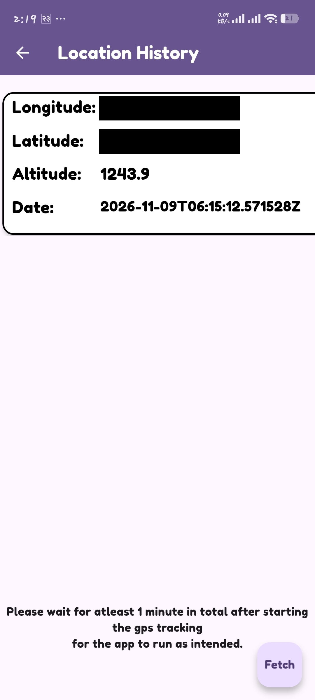
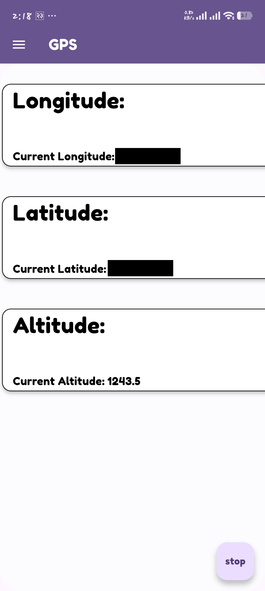
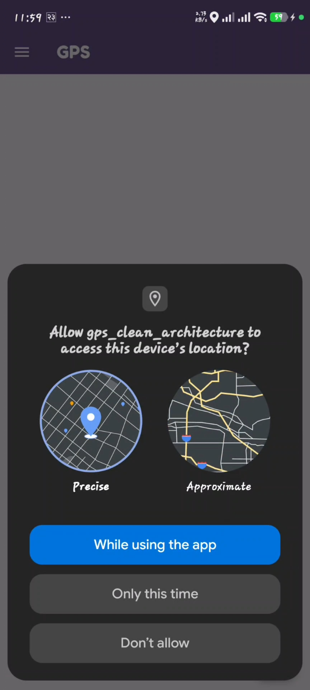
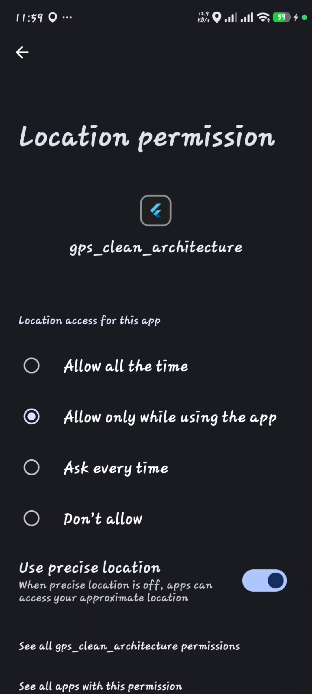
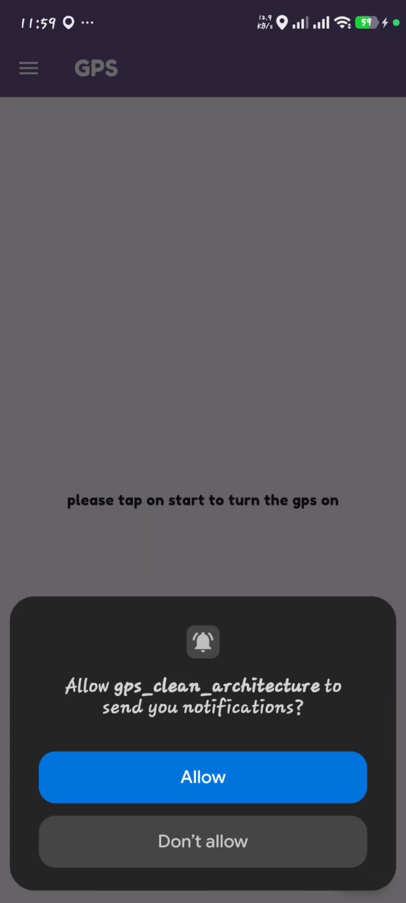
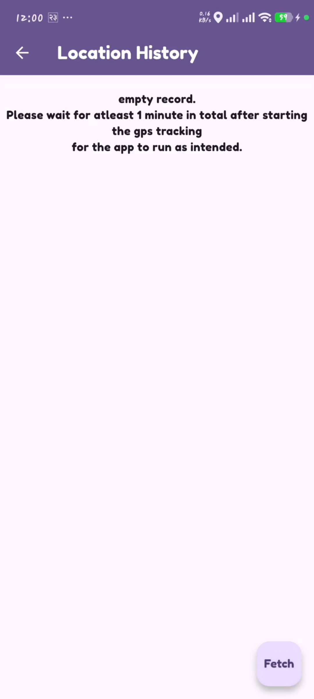

GPS_CLEAN_ARCHITECTURE:

  
  
  
  
  
  

THIS README CONSISTS OF:

1.)FRONTEND
2.)BACKEND

1.)FRONTEND:

The layers defined are:

#UI,
#STATE MANAGEMENT,
#USER REPOSITORY,
#DATA CLASS,
#SERVICE CLASS

THE FLOW OF DATA HAPPENS LIKE:

##SERVICE(DI THROUGH GET IT)-->##USER REPOSITORY(CALLS DATA CLASS)-->##DATA CLASS(FILTERS DATA AND CONVERTS THEM INTO USER DEFINED DATA TYPES)-->##STATEMANAGEMENT(GETS DATA THROUGH USER REPOSITORY)-->##UI(DATA IS DISPLAYED.)

#SERVICES USED:

#FRONTEND:

flutter - framework for android/ios support(i havent accounted for ios cause i heavily focused on android os when learning.)
Hive - for persistent data
Getit - as a service locator for dependency injection
Statemanagement-Bloc
Figma - for a simple and minimalistic UI design
Dio- to talk with server to post and get the data.

#Backend:

Golang - used to create a fast and light backend server
Postgresql - used in testing
Render - to deploy the backend
Supabase - to handle the data

Resources request:

i had released the prototype of the project a few weeks ago in which i learnt how the operating system behaves,why i needed to put wake_lock in android manifest,foreground services,foreground location services and what i learnt is wakelock prevents the operating system from killing the app completely and foreground services are for the app to run in the background....

foreground services lets me to provide a visible persistent notification bar due to which the os doesnt kill my app when its minimized.

wakelock is a method to prevent cpu from sleeping.i have not removed it even though my app doesnt utilize it right now cause in future if i decide to provide the update for it i know its still in the android manifest.

#Permissions:

I used permission handler to handle the processes:

The permissions requested are:
location when in use - for when the app is open
location always - for when the app is in background
notification - for foregroundservices to show the persistent notification

#roles of each layer:

The app is divided into several layers according to their respective roles:
UI:
go_router.dart
homepage.dart
locationhistory.dart
longitudecontainer.dart
main.dart
recordcontainer.dart

this is where the ui buttons,list view builder etc sit..it is basically consist of the things user can interact with.

go_router.dart:

this file consists of go_router with routes this handles the navigation within the app in a clean,self contained way such that the debugging is easier.

homepage.dart:

this file consists of the ui elements and bloc builder with floating button which is responsible for desplaying the provided data and send triggers(activate events) to build the ui.this file knows nothing about where the data comes from.its main job is just to display the incoming data.

locationhistory.dart

this file very similar to homepage.dart but instead of showing the current reading it shows the histroy of data given to it.

longitudecontainer.dart

this file is the extension to homepage.dart it consists of the container widget where all the incoming data are placed in their respective position.the ui are separated this way to make the debugging easier so that the homepage where the actual data arrives from pipeline is clean,since i have longitudecontainer,if i need to change something in the container,i can just edit once and the instances of the container will all be altered.

main.dart:
this is the starting point of the program where hive and dependencies are initialized,blocprovider is also initialized here.

recordcontainer.dart

it is same as longitudecontainer but for locationhistory.dart

#Services/dependencies:
services are those files that consist of the things that need to be accessed throughout the app's lifetime.they are the ones that perform some action and provide output.they do not change by the data they process.they are the non changing entities and are unaffected by the data they process.

hivesetup.dart
locator.dart
statemanagement.dart
talktoserver.dart

hivesetup.dart:
it is used to initialize and open hive boxes to store the data.

hive_registrar.g.dart:
it is a typeadapter file.hive only knows how to store the primitive datatypes.if user wants to store the userdefined datatype then a typeadapter must be created in order for the hive to know how to store the file and how to provide it to the user in case they need it.

locator.dart:
this is where the singleton instances of the services are created.since the app needs them to function,a singleton/lazysingleton instances of them are defined so that allocation/deallocation,memory leak can be prevented.the global single instances are kept so that the app can request the service whenever and from wherever it needs them.

statemanagement.dart:
the true brain of the frontend.this is where the dormant services are awakened/triggered.this is the file that dictates which services run at a given time according to its triggered events.this file acts on the triggers provided by the ui to initiate the respective events.

geolocator_setup.dart:
this file is used to know the current allowed permissions and request permissions with the user with the help of.request(). and returns true if the location always is granted,false if the location always is denied but location when in use is allowed,and returns null when the location when in use is denied.

data:

it is the layer concerned with data and nothing else

hold_data.dart
dataRepository.dart
deviceinfo.dart
geolocator_Readings.dart
hold_Data.g.dart
retrieveddataclass.dart

hold_data.dart:

the purpose of this file is to  convert the raw unstructured data/collection of data into structured data consisting of fields such as longitude,latitude,altitude etc.which helps in type safety and also filters the incoming data by keeping only the data returned by its factory function.

datarespository.dart:

this is the file where all the logic related to data happens.this is where the factory function of the hold_data class is called.this is where the function is defined that stores the incoming data from geolocator.this file is responsible to decide where the data is fetched from and where the data goes.it is responsible to cache the data into box and send it to the backend and as well as retrieval of that data happens here.

deviceinfo.dart

this is where unique id with respect to the device is created which helps uniquely identifying the data when we need to retrieve it from backend.this is created only once.

geolocator_readings:

here locationsettings is created.it is used to create a stream getter provided by geolocator which runs only when invoked.this getter is sent to the userrepository for further operation.i could send it to bloc too but it would violate the clean architecture because if anything were to depreciate or change my whole bloc would have to be debugged and potentially the ui too.in clean architecture,services are always injected rather than passed and the services related to data are always injected into userrepository.

hold_Data.g.dart:

this file is responsible to define how to store the incoming Position object into distinct fields like longitude,altitude,latitude etc and return them when needed.

retrieveddataclass.dart:

this class is just as same as hold_data.dart file but rather than reading the positionbject from gps,it reads and converts them into user defined datatype called retrieved_data.

2.)BACKEND

Services used:

#Golang - to design backend server.
#Postgresql - to test my backend server locally.
#Supabase - to deploy my postgresql.
#Render - to deploy my backend server.

golang:
it is a superfast language where it is compiled into binary.since it is all converted into machine code at the same time it is blazingly fast if compared to interpreted languages like python which is relatively slow.since it consists of built in libraries like os,net/http.encoding/json i felt like this was a greate starting point for me to learn backend.

Backend server design:

i created struct that would consist of the fields and created jsontags that would save the incoming data from dio(using tojson function in the app).

main():here i retrieved the environment variable from render that has "DATABASE_URL"

IF THE environment variable was absent i atleast made a provision to let it connect to my postgre as a last option.

i parsed that string,go returned a config with the fields that were broken down from the database url into the go readable struct consisting of password,database name etc.

with the config,i created a connection with the database

pinged the database to know if it is online or not.

defer is the function that runs any function when its parent function is about to die.

i made sure to close the connection between the database and the backend when the  whenever any error occured before going to the listenandserve function(not having defer dbpool.close() wouldnt matter in this case because there isnt any function that would abruptly close the backend after the pool has been opened so not having it there would not be of any problem.)

checked if the incoming request for each path is in accordance with the one defined in backend if not it throws the error.

it saves the incoming coordinates from frontend and inserts it into the database. r.context is there so that there exists atomic transaction of data.

when retrieving data from database,i checked the deviceid retrieved from queryparameter from dio in backend,matched the tuple/row to it, the record can be multiple thats why i mapped them into the struct,created slice of tpe locationdata and sent it if it was a get data.

since the device id is ultimately stored into the device itself and no server side validation is done,although its highly unlikely to match it since i am using uuid(universally unique identifiers v4),sophisticated users can breach into other people's data by changing their deviceid(uuid) to another person's uuid.

