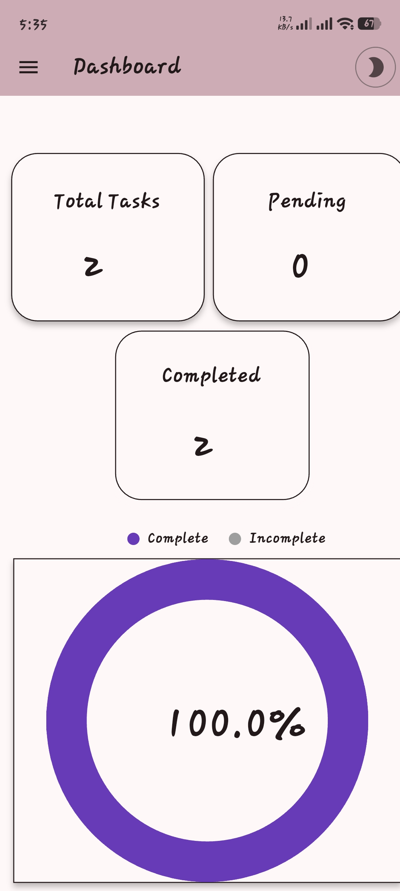
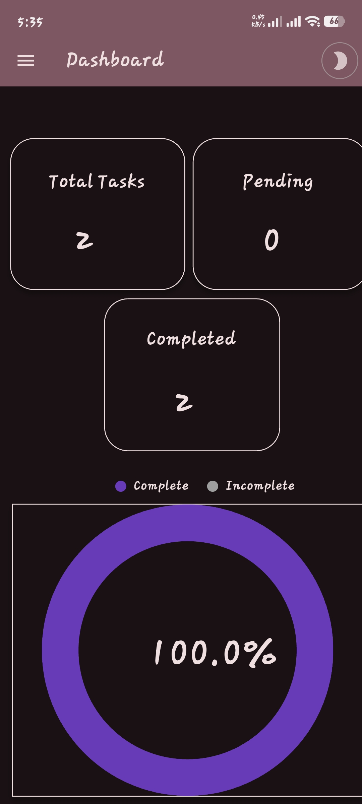
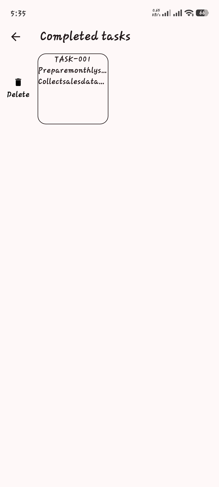
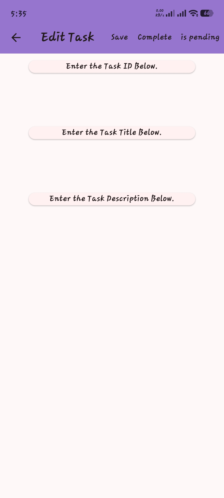
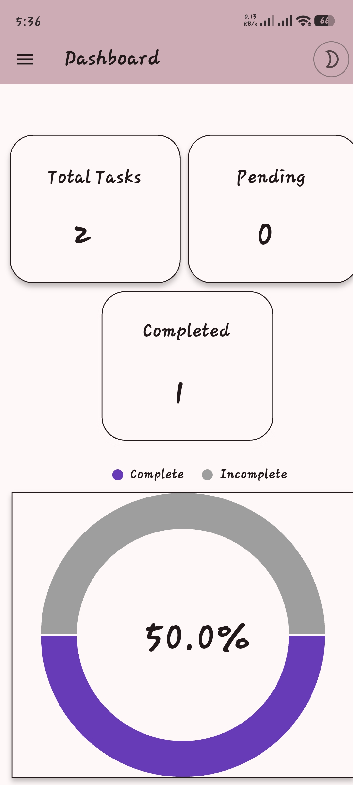

# Task Manager

A Flutter app to add, manage, and track tasks, with a chart showing the percentage of completed tasks.

## Features
- Add, edit, and delete tasks
- Swipe actions on tasks (flutter_slidable)
- Completion progress chart (fl_charts)
- Tasks saved locally with Hive, so they persist after closing the app

## Tech stack
Flutter, Dart, hive_ce, go_router, get_it, fl_charts, flutter_slidable

## How to run
1. Clone the repo and open the `taskmanager` folder
2. `flutter pub get`
3. `flutter run`

## Screenshots

  
  
  
  
  
  

